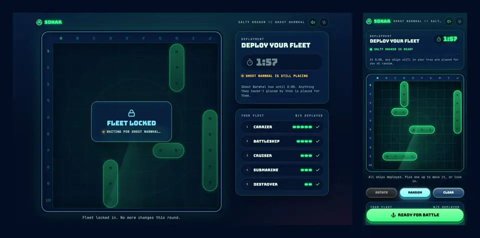
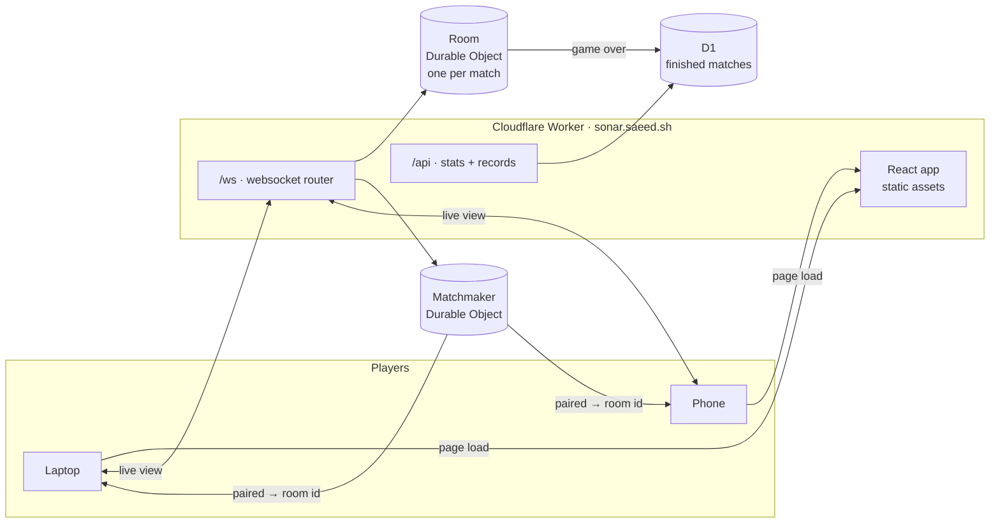

<div align="center">


# Sonar

**Classic Battleship against a real person, right in your browser.**<br>
Send a friend a link, or hit Quick Match and get paired with a stranger.<br>
No sign-up, no install. Works on a laptop or a phone.

### [▸ Play at sonar.saeed.sh](https://sonar.saeed.sh)

[](https://github.com/Stringsaeed/multiplayer-battleship/actions/workflows/ci.yml)
[](LICENSE)
[](https://workers.cloudflare.com)



<sub>A real match, laptop vs. phone, from first shot to "Victory" (1.6× speed).</sub>

</div>

## The game

- **The real rules.** 10×10 grid with five ships (5, 4, 3, 3, 2), one shot per turn, and the opponent names a ship when it sinks.
- **Two ways in.** A private room with a 6-character code and a share link, or Quick Match with whoever is next in line.
- **Nobody stalls.** You get 30 seconds a shot, or you auto-miss. Unplaced ships get auto-placed after 2 minutes. Disconnect for 60 seconds and you forfeit.
- **No accounts.** You get a random callsign like _Salty Kraken_. Your record lives with your browser, and everyone shares the global stats.
- **It sounds and feels like sonar.** Pings, splashes and sinks, an optional ambient hum, and vibration on Android.
- **Rematch.** Once both players accept, you're back to placing ships.

## How it works

One Cloudflare Worker serves everything: the app, the API, and the websockets. Each match is its own Durable Object, and that object is the only thing that knows where the ships are.



- **The server holds the truth.** The rules are one pure function, `step(match, action)` in [`packages/game/src/match.ts`](packages/game/src/match.ts). It turns a match plus an action into the next match, or a typed rejection such as "not your turn". The browser only sends intents (`Fire A7`) and draws what it gets back.
- **You can't peek.** After every change, each seat gets its own view of the match. Your view never includes where the enemy's ships are, only your hits and misses. A property test plays out random full games and checks every view along the way for a leaked ship.
- **One alarm per room.** The room keeps a single Durable Object alarm set to its next deadline (turn clock, placement clock, or reconnect grace). When it fires, the reducer applies the timeout: an auto-miss on a random open cell, auto-placing the ships you left in your tray, or a forfeit.
- **Reconnects are free.** Refresh, lose signal, or switch from Wi-Fi to cellular: you rejoin with the same token and get the full current view back.
- **Typed end to end.** The wire protocol is [Effect Schema](https://effect.website), and the same schemas validate messages on both sides. The `/api` contract is an Effect `HttpApi` shared by the Worker and the client.

### Built with

|                     |                                                                                                                          |
| ------------------- | ------------------------------------------------------------------------------------------------------------------------ |
| **Game + protocol** | TypeScript, [Effect 4](https://effect.website) (Schema, HttpApi, Clock/Random in the reducer)                            |
| **Server**          | Cloudflare Workers, Durable Objects via [PartyServer](https://github.com/cloudflare/partykit), D1                        |
| **Client**          | React, TanStack Router, Effect Atom, Tailwind v4 + shadcn/ui, Motion, Howler                                             |
| **Infra**           | [SST v4](https://sst.dev) (Worker, DOs, D1, domain, a stage per PR), GitHub Actions                                      |
| **Tooling**         | [Vite+](https://viteplus.dev) monorepo (`vp`), Vitest + `@effect/vitest` property tests, Workers vitest pool, Playwright |
| **Sound**           | ElevenLabs Sound Effects API → ffmpeg (loudness-normalized Opus + AAC)                                                   |

## Repo layout

| Path                             | What's inside                                                                                          |
| -------------------------------- | ------------------------------------------------------------------------------------------------------ |
| [`packages/game`](packages/game) | Rules, reducer, per-seat views, wire protocol, and the `HttpApi` contract, shared by client and server |
| [`apps/worker`](apps/worker)     | The Worker: `Room` + `Matchmaker` Durable Objects, `/api`, D1 migrations                               |
| [`apps/web`](apps/web)           | The React app, served as the Worker's static assets, plus the sound pipeline                           |

## Run it locally

You need Node 24 and [Vite+](https://viteplus.dev) (`vp`).

```sh
vp install
vp run @sonar/worker#db:migrate:local   # once, and after adding a migration
vp run dev                              # app + Worker + DOs + D1 in one Vite server
```

Open two browser windows (or a window and your phone on the same network) to play yourself.

| Command                      | Does                                                                       |
| ---------------------------- | -------------------------------------------------------------------------- |
| `vp check`                   | Format, lint, and type-check everything                                    |
| `vp run -r test`             | Reducer property tests (`game`) and Worker tests inside workerd (`worker`) |
| `vp run web#e2e`             | Playwright: full two-player games on desktop, Pixel 7, and a 375px phone   |
| `vp run web#build`           | Production build of the app + Worker                                       |
| `vp run @sonar/worker#types` | Regenerate `Env` types after editing `wrangler.jsonc`                      |

`E2E_BASE_URL=https://… pnpm --filter @sonar/web exec playwright test` points the e2e suite at a deployed stage. Those games count toward that stage's stats, so use a preview stage rather than production.

## Sound

Every effect was generated with the ElevenLabs Sound Effects API from the prompts in [`apps/web/sfx/prompts.json`](apps/web/sfx/prompts.json). Each cue has several raw takes in `apps/web/sfx/takes/`, and the chosen one is recorded in `apps/web/sfx/picks.json`.

```sh
ELEVENLABS_API_KEY=... vp run @sonar/web#sfx:generate [cue ...]   # fill in missing takes
vp run @sonar/web#sfx:encode                                     # picks → public/sfx (.webm + .m4a)
```

With the dev server running, [`/dev/sounds`](http://localhost:5173/dev/sounds) is a soundboard for auditioning every take. Picking one re-encodes it on the spot.

## Deploy

[`sst.config.ts`](sst.config.ts) describes all the infrastructure: the Worker with the app as its static assets, both Durable Objects, D1 (migrations run on any deploy that changes them), and the domain on the `production` stage. SST keeps its state in your Cloudflare account.

```sh
vp exec sst install                        # once: providers and types
vp run web#build && vp exec sst deploy     # your personal stage
vp run deploy                              # production
```

CI ([`.github/workflows/ci.yml`](.github/workflows/ci.yml)) checks every push and PR, deploys each PR to its own `pr-<n>` stage (removed when the PR closes), and deploys `main` to production. It needs the `CLOUDFLARE_API_TOKEN` and `CLOUDFLARE_DEFAULT_ACCOUNT_ID` repository secrets.

`apps/worker/wrangler.jsonc` only drives local dev and the Worker tests, so keep its bindings in sync with `sst.config.ts`.

## License

[MIT](LICENSE), code and sound effects alike.
